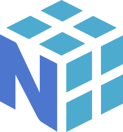

🇫🇷

<h2><b>Bonjour, je suis Mickael</b></h2><h4><i>« Étudiant en Bac +5  Big Data & IA, je cherche une alternance en data / IA pour appliquer ce que j'apprends à des cas réels. »</i></h4> 
<h3><b>🌟 Projets phares</b></h3>

**Projet** | **Description** | **Stack technique**
:-:|---|--:
**[Linceul-Audit](https://github.com/MiKL5/linceul-audit)** <kbd><i>En conception</i></kbd> | Détection de fraude financière par corrélation de flux et de données non structurées | `Python`, `PostgreSQL` *Apprentissage de* `Java`, `ONNX`, `pgvector`
**[Audit RGPD d’une IA](https://github.com/MiKL5/gdpr-ai-compliance-audit-housing-ml)** | Application Streamlit de prédiction 100 % conforme aux normes européennes | `Python`, `Streamlit`, `Random Forest`, `Scikit-learn`
**[Books to mongo](https://github.com/MiKL5/web-scraping/blob/main/projects/b2mongo)** | Pipeline ETL de web scraping bibliographique | `Python`, `Scrapy`, `MongoDB`
**[Réduction de dimensionnalité](https://github.com/MiKL5/machine-learning-projects/blob/main/projects/dimensionReductionUsingLDA-SVD)** | Comparatif LDA et SVD tronquée pour réduire la dimensionnalité | `Python`, `Scikit-learn`, `Matplotlib`, `Jupyter Notebook`

<h3><b>Technologies</b></h3>

Langages | Bibliothèques de data science | Frameworks
:-:|:-:|:-:
||

SGBD | BI et environnements de données | Outils
:-:|:-:|:-:
<a href="https://github.com/MiKL5/TSQL"> </a>|<a href="#"><picture><source media="(prefers-color-scheme: dark)" srcset="https://cdn.simpleicons.org/jupyter/white"><source media="(prefers-color-scheme: light)" srcset="https://upload.wikimedia.org/wikipedia/commons/3/38/Jupyter_logo.svg?utm_source=commons.wikimedia.org&utm_campaign=index&utm_content=original"></picture></a>|<a href="#"> </a>

 <!--<h3><b>📫 Restons en contact !</b></h3>-->

 

🇬🇧

<h2><b>Hello, I’m Mickael</b>  </h2>
</h4>
<i>« I’m a Big Data & AI student looking for an apprenticeship (alternance) in data and AI, to apply my skills in real situations. »</i></h4> 
<h3><b>🌟 Featured Projects</b></h3>

**Project** | **Description** | **Tech Stack**
:-:|---|--:
**[Linceul-Audit](https://github.com/MiKL5/linceul-audit)**  <kbd><i>In design</i></kbd> | Financial fraud detection by correlating flows and unstructured data | `Python`, `PostgreSQL` *learning:* `Java`, `ONNX`, `pgvector`
**[GDPR Audit of an AI](https://github.com/MiKL5/gdpr-ai-compliance-audit-housing-ml)** | Streamlit prediction app that is 100% compliant with European standards | `Python`, `Streamlit`, `Random Forest`, `Scikit-learn`
**[Books to mongo](https://github.com/MiKL5/web-scraping/blob/main/projects/b2mongo)** | ETL pipeline for bibliographic web scraping | `Python`, `Scrapy`, `MongoDB`
**[Dimensionality Reduction](https://github.com/MiKL5/machine-learning-projects/blob/main/projects/dimensionReductionUsingLDA-SVD)** | Comparison of LDA and truncated SVD to reduce dimensionality | `Python`, `Scikit-learn`, `Matplotlib`, `Jupyter Notebook`

<h3><b>Technologies</b></h3>

Languages | Data Science Libraries | Frameworks
:-:|:-:|:-:
||

DBMS | BI and Data Environments | Tools
:-:|:-:|:-:
<a href="https://github.com/MiKL5/TSQL"> </a>|<a href="#"><picture><source media="(prefers-color-scheme: dark)" srcset="https://cdn.simpleicons.org/jupyter/white"><source media="(prefers-color-scheme: light)" srcset="https://upload.wikimedia.org/wikipedia/commons/3/38/Jupyter_logo.svg?utm_source=commons.wikimedia.org&utm_campaign=index&utm_content=original"></picture></a>|<a href="#"> </a>

 <!--<h3><b>📫 Let’s connect!</b></h3>-->

 

